<p align="center">
  
</p>

<p align="center">
  <a href="https://github.com/ishandutta2007/Awesome-Awesome-Awesome"></a><a href="https://discord.gg/jc4xtF58Ve"></a>
  <a href="https://github.com/ishandutta2007/Awesome-PDF-Editor-Management/stargazers"></a>
  <a href="https://github.com/ishandutta2007/Awesome-PDF-Editor-Management/network/members"></a>
  <a href="https://github.com/ishandutta2007/Awesome-PDF-Editor-Management/blob/main/LICENSE"></a>
  <a href="https://github.com/ishandutta2007/Awesome-PDF-Editor-Management/pulls"></a>
  <a href="https://github.com/ishandutta2007"></a>
</p>

---

# 📄 Awesome PDF Editor & Management Ecosystem

> **A comprehensive, SEO-optimized, community-curated collection of top SaaS platforms and open-source GitHub projects for PDF editing, page-level management, document workflows, OCR, local processing, and self-hosted privacy toolkits.**

Whether you are seeking an enterprise-grade cloud suite or a private, self-hosted Docker container to process confidential contracts without third-party data leaks, this guide tracks the best commercial and open-source solutions available.

---

## 📑 Table of Contents

- [🔍 SEO Overview & Keywords](#-seo-overview--keywords)
- [📊 Sector Overview & Market Dynamics](#-sector-overview--market-dynamics)
- [🏢 SaaS & Hosted Commercial Platforms](#-saas--hosted-commercial-platforms)
- [🔓 Open-Source GitHub Projects](#-open-source-github-projects)
- [🛠️ Feature Comparison Matrix](#-feature-comparison-matrix)
- [💡 Architectural Guide: Building a Privacy-First PDF Stack](#-architectural-guide-building-a-privacy-first-pdf-stack)
- [🤝 How to Contribute](#-how-to-contribute)
- [⚖️ Disclaimer](#-disclaimer)
- [📈 Star History](#-star-history)
- [💖 Support & Sponsoring](#-support--sponsoring)

---

## 🔍 SEO Overview & Keywords

* **Primary Keywords**: PDF Editor, PDF Management, Self-Hosted PDF, Open Source PDF Editor, Stirling-PDF, Paperless-ngx, PDF OCR, Merge PDF, Split PDF, PDF Compress, Browser-Based PDF Tools, Adobe Acrobat Alternative.
* **Secondary Keywords**: Offline PDF Editor, Linux PDF Annotation, Xournal++, PDFsam, Documenso e-sign, WebAssembly PDF, Docker PDF tools, Privacy-preserving document processing, PyMuPDF, pdfcpu, PDF.js renderer.
* **Target Audience**: Software Engineers, DevOps/SysAdmins, Privacy Officers, Legal & Financial Ops Teams, Students, and Researchers managing sensitive documents.

---

## 📊 Sector Overview & Market Dynamics

* **Market Size & Growth**: The global dedicated PDF software market is estimated at **$2.67 billion to $4.13 billion by 2026** (expanding at an **8% to 11.5% CAGR**), while the broader Document Management Software (DMS) market is surging toward **$9.74 billion to $10.62 billion** with a rapid **12% to 15% CAGR**, fueled by enterprise paperless digital transformation and generative AI document assistants.
* **Market Dynamics & Fragmentation**: The market exhibits a **bifurcated structure**. At the enterprise tier, the market is **heavily concentrated** around Adobe Inc. (commanding ~60% to 70% commercial market share as the reference standard). However, the mid-market and SMB space is **moderately fragmented** among viable competitors (Foxit, Nitro, Wondershare PDFelement), high-volume browser utility suites (Smallpdf, Sejda), and an accelerating **open-source disruption** where self-hosted toolkits (e.g., Stirling-PDF, Paperless-ngx, Documenso) provide zero-data-leakage alternatives to subscription lock-in.

---

## 🏢 SaaS & Hosted Commercial Platforms

The table below catalogs notable commercial and cloud PDF editor platforms, **sorted descending by company size / market valuation / revenue**.

| Product & Company | Company Size / Valuation / Revenue | Starting Price | Free Tier / Trial Limits | Key Capabilities & Best For |
| :--- | :--- | :--- | :--- | :--- |
| [**Adobe Acrobat Pro**](https://www.adobe.com/acrobat.html) <br> *(Adobe Inc.)* | **Market Cap: ~$100 Billion+** <br> *(FY24 Revenue: $21.51B)* | **$12.99 / month** *(Standard, annual commit)* <br> **$19.99 / month** *(Pro, annual commit)* | **7-day free trial** of Acrobat Pro (full access to all 70+ tools, credit card required). <br> **Adobe Acrobat Reader** is permanently free for viewing, printing, commenting, and signing. | **The enterprise gold standard.** End-to-end editing, OCR, form generation, deep redaction, cloud review, and enterprise security compliance. |
| [**Wondershare PDFelement**](https://pdf.wondershare.com/) <br> *(Wondershare Tech Group)* | **Market Cap: ~$1.4 Billion** <br> *(Annual Revenue: ~$210M)* | **$79.99 / year** *(Yearly Plan)* <br> or **$129.99** *(Perpetual License)* | **Free forever plan** with watermark stamped on all saved/exported files. Conversions & OCR limited to **first 3 pages**; file combining capped at **max 3 files (≤ 20 MB)**. | **Affordable Acrobat alternative.** Polished desktop interface with AI summaries, full text/image editing, OCR, and form creation. |
| [**Foxit PDF Editor**](https://www.foxit.com/pdf-editor/) <br> *(Foxit Software)* | **Market Cap: ~$746 Million** <br> *(LTM Revenue: ~$170M)* | **$10.99 / month** *(or $129.99/yr Standard)* <br> **$159.99 / year** *(Editor+)* | **14-day free trial** of PDF Editor+ with full feature access (no credit card required). <br> **Foxit PDF Reader** is free forever for viewing, basic forms, commenting, and **300 monthly AI credits**. | **High-speed enterprise suite.** Fast rendering, deep annotation, automated smart redaction, eSign integration, and low memory footprint. |
| [**Nitro PDF Pro**](https://www.gonitro.com/) <br> *(Potentia Capital / Nitro)* | **Enterprise Value: ~$500 Million+** <br> *(ARR: ~$65M+)* | **$15.00 / user/month** *($180/yr billed annually)* <br> or **$270.00** *(3-year fixed upfront)* | **14-day free trial** with unrestricted desktop & cloud features (no credit card required). <br> **Nitro Workspace** provides basic free account for simple web conversions and views. | **Corporate workflow automation.** Seamless Microsoft 365 integration, batch PDF conversion, digital signature workflows, and team deployment. |
| [**Smallpdf**](https://smallpdf.com/) <br> *(Smallpdf GmbH)* | **Privately Held (Est. ARR: ~$10M–$12M)** <br> *(50M+ monthly active users)* | **$9.00 / month** *(billed annually at $108/yr)* <br> or **$12.00 / month** *(monthly billing)* | **Free forever plan** capped at **2 tasks per day** (resets midnight CET), basic compression, and **50 MB max file size**. Also offers a 7-day Pro free trial. | **Frictionless browser-based utility.** Quick drag-and-drop merging, splitting, image-to-PDF conversion, compression, and basic e-signing. |
| [**PDF-XChange Editor**](https://www.pdf-xchange.com/) <br> *(Tracker Software Products)* | **Privately Held (Est. Revenue: ~$5M–$10M)** <br> *(Bootstrapped & profitable)* | **$56.00** *(One-time perpetual license)* <br> or **$79.00** *(Editor Plus perpetual)* | **Free forever version** includes **over 70% of features** (viewing, commenting, text edits) with zero watermarks. Using licensed "Pro" features applies a demo watermark. | **Ultra-fast Windows native powerhouse.** Deeply customizable, granular OCR controls, form builder, and perpetual one-time pricing without subscriptions. |
| [**Sejda PDF**](https://www.sejda.com/) <br> *(Sejda BV)* | **Privately Held (Est. Revenue: ~$3M–$7M)** <br> *(Bootstrapped & self-funded)* | **$5.00 / week pass** <br> **$7.50 / month** *(Web monthly)* <br> **$63.00 / year** *(Desktop + Web)* | **Sejda Web**: Free forever up to **3 tasks per hour** (max 200 pages or 50 MB per file). <br> **Sejda Desktop**: Free forever up to **3 tasks per day**. | **Versatile online/offline editor.** Direct inline text editing on existing PDF paragraphs, page cropping, PDF split/merge, and optical character recognition. |
| [**PDF Candy**](https://pdfcandy.com/) <br> *(Icecream Apps Ltd)* | **Privately Held (Est. Revenue: ~$2M–$5M)** <br> *(Consumer utility suite)* | **$6.00 / month** *(Web monthly)* <br> **$48.00 / year** *($4.00/mo billed annually)* <br> or **$99.00** *(Lifetime)* | **Free forever plan** strictly limited to **1 task per 1 hour** with a **10 MB maximum file size** limit and server queuing. | **All-in-one web toolbox.** 47+ specialized browser utilities for quick PDF repair, format conversion, metadata editing, page extraction, and watermarking. |

---

## 🔓 Open-Source GitHub Projects

Below are the most prominent open-source projects in the PDF ecosystem. Each repository features a social Stars_Badge linking directly to that repository's stargazers page, **sorted descending by GitHub Stars_Count**.

### 1. [Stirling-PDF](https://github.com/Stirling-Tools/Stirling-PDF) [](https://github.com/Stirling-Tools/Stirling-PDF/stargazers)
* **Category**: Self-Hosted Web Toolkit & All-in-One Utility Suite
* **License**: Open-Core / GPL-3.0
* **Description**: The #1 open-source self-hosted PDF manipulation web application on GitHub. Bundles 50+ tools in a single Docker container.
* **Key Features**: Merge, split, rotate, reorganize, compress, repair, OCR via Tesseract, convert to/from Office formats, watermark, password protection, redaction, and multi-user login with SSO/OIDC.
* **Architecture**: Client-side execution where possible; server tasks run in-memory and temporary files are pruned automatically.
* **Quick Docker Deploy**:
  ```bash
  docker run -d -p 8080:8080 -v ./stirling_data:/usr/share/tessdata stirlingtools/stirling-pdf:latest
  ```

---

### 2. [PDF.js](https://github.com/mozilla/pdf.js) [](https://github.com/mozilla/pdf.js/stargazers)
* **Category**: Web Standards PDF Viewer & Parser Engine
* **License**: Apache-2.0
* **Description**: Mozilla's foundational, community-driven HTML5 and Web Standards PDF reader and viewer engine.
* **Key Features**: Parses and renders PDFs directly inside the browser using HTML5 Canvas without any binary plugins or server calls. Powers Firefox's native PDF viewing experience and hundreds of web applications worldwide.

---

### 3. [Paperless-ngx](https://github.com/paperless-ngx/paperless-ngx) [](https://github.com/paperless-ngx/paperless-ngx/stargazers)
* **Category**: Self-Hosted Document Management & Archival System (DMS)
* **License**: GPL-3.0
* **Description**: Community-driven self-hosted document management system that transforms physical paper and digital PDFs into searchable, organized digital archives.
* **Key Features**: Automated machine-learning document tagging, multi-language OCR, full-text search, automated email ingest, customizable workflows, and comprehensive REST API.

---

### 4. [KOReader](https://github.com/koreader/koreader) [](https://github.com/koreader/koreader/stargazers)
* **Category**: Document Viewer & E-Reader Engine
* **License**: AGPL-3.0
* **Description**: Versatile document and ebook viewer engineered for E-Ink screens, desktop, Android, and embedded devices.
* **Key Features**: Exceptional PDF reflow support, two-column smart panning, fine-grained margin cropping, high-performance rendering, and comprehensive offline annotation.

---

### 5. [@react-pdf/renderer](https://github.com/diegomura/react-pdf) [](https://github.com/diegomura/react-pdf/stargazers)
* **Category**: Declarative React PDF Generation Framework
* **License**: MIT
* **Description**: Declarative React framework for building custom PDF documents on the browser and server.
* **Key Features**: Flexbox-based layout system, native styling, live browser preview components, and lightweight Node.js rendering.

---

### 6. [Xournal++](https://github.com/xournalpp/xournalpp) [](https://github.com/xournalpp/xournalpp/stargazers)
* **Category**: Handwriting, Stylus Annotation & Note-Taking
* **License**: GPL-2.0
* **Description**: Modern, open-source handwriting, sketching, and PDF annotation software written in C++ with GTK.
* **Key Features**: Pressure-sensitive stylus input, layer support, PDF background text selection, mathematical LaTeX formulas, audio recording synced with notes, and PDF export.

---

### 7. [Documenso](https://github.com/documenso/documenso) [](https://github.com/documenso/documenso/stargazers)
* **Category**: Self-Hosted Digital Signatures & Contract Workflows
* **License**: AGPL-3.0
* **Description**: The open-source DocuSign alternative for cryptographic signing and contract lifecycle management.
* **Key Features**: Self-hostable e-signature platform, tamper-evident cryptographic hashing, audit logs, recipient signing sequences, template library, and modern Next.js/Prisma stack.

---

### 8. [pdfmake](https://github.com/bpampuch/pdfmake) [](https://github.com/bpampuch/pdfmake/stargazers)
* **Category**: Declarative JavaScript Document Generation
* **License**: MIT
* **Description**: Pure JavaScript client/server PDF generation engine using declarative JSON document definitions.
* **Key Features**: Multi-page tables, auto-wrap columns, custom fonts, vector paths, data URLs, and zero binary dependencies.

---

### 9. [PyMuPDF](https://github.com/pymupdf/PyMuPDF) [](https://github.com/pymupdf/PyMuPDF/stargazers)
* **Category**: Python High-Performance PDF Engine
* **License**: AGPL-3.0 / Commercial
* **Description**: High-performance Python bindings for MuPDF, one of the fastest PDF rendering and extraction engines in existence.
* **Key Features**: Blazing fast text extraction, rasterizing PDF pages into images, lossless redaction, annotation creation, and form inspection.

---

### 10. [PDFKit](https://github.com/foliojs/pdfkit) [](https://github.com/foliojs/pdfkit/stargazers)
* **Category**: Node.js & Browser PDF Generation Library
* **License**: MIT
* **Description**: Foundational PDF generation library for Node.js and the browser with comprehensive vector graphics support.
* **Key Features**: Streaming document generation, subset font embedding, image integration, encryption, and vector drawing primitives.

---

### 11. [pypdf](https://github.com/py-pdf/pypdf) [](https://github.com/py-pdf/pypdf/stargazers)
* **Category**: Pure-Python Manipulation & Transformation Library
* **License**: BSD-3-Clause
* **Description**: Pure-Python library capable of splitting, merging, cropping, and transforming pages of PDF files without external C libraries.
* **Key Features**: 100% Python codebase, encryption/decryption, metadata reading and updating, watermarking, and AcroForm extraction.

---

### 12. [WeasyPrint](https://github.com/Kozea/WeasyPrint) [](https://github.com/Kozea/WeasyPrint/stargazers)
* **Category**: HTML/CSS to PDF Visual Rendering Engine
* **License**: BSD-3-Clause
* **Description**: Visual rendering engine that transforms HTML and CSS into print-ready PDF documents.
* **Key Features**: Full CSS Paged Media standards compliance (page counters, headers/footers, bleeds, page breaks), ideal for automated invoices, receipts, and reports.

---

### 13. [pdfcpu](https://github.com/pdfcpu/pdfcpu) [](https://github.com/pdfcpu/pdfcpu/stargazers)
* **Category**: Go PDF CLI & Processing Engine
* **License**: Apache-2.0
* **Description**: High-performance PDF processing engine and CLI written entirely in Go with zero runtime dependencies.
* **Key Features**: Ultra-fast CLI and Go API for validation, slicing, optimizing, stamping, watermarking, decrypting, and importing/exporting attachments.

---

### 14. [pdf-lib](https://github.com/Hopding/pdf-lib) [](https://github.com/Hopding/pdf-lib/stargazers)
* **Category**: TypeScript/JavaScript In-Browser & Server PDF Editor
* **License**: MIT
* **Description**: Pure TypeScript library for creating and modifying PDF documents in any JavaScript runtime (Node, Deno, browser).
* **Key Features**: Zero native dependencies, draw text and vector shapes, fill and flatten interactive forms, embed images and custom fonts.

---

### 15. [PDF Arranger](https://github.com/pdfarranger/pdfarranger) [](https://github.com/pdfarranger/pdfarranger/stargazers)
* **Category**: Desktop Visual Page Reorganizer
* **License**: GPL-3.0
* **Description**: Lightweight Python GTK desktop application for visual page-level reordering, cropping, splitting, and merging.
* **Key Features**: Simple drag-and-drop page reorganization, page rotation, duplicate/delete operations, metadata editing, and zero network footprint.

---

### 16. [pdf2htmlEX](https://github.com/pdf2htmlEX/pdf2htmlEX) [](https://github.com/pdf2htmlEX/pdf2htmlEX/stargazers)
* **Category**: Pixel-Perfect PDF to HTML Converter
* **License**: GPL-3.0
* **Description**: Converts PDF to HTML with pixel-perfect visual fidelity, preserving typography, layout, formulas, and vector elements.
* **Key Features**: Web font generation, scalable layout conversion, high fidelity for research papers, books, and mathematical publications.

---

### 17. [PDFsam Basic](https://github.com/torakiki/pdfsam) [](https://github.com/torakiki/pdfsam/stargazers)
* **Category**: Desktop Offline Page Management
* **License**: AGPL-3.0
* **Description**: Mature, battle-tested open-source desktop utility for offline PDF page management since 2006.
* **Key Features**: Merge with AcroForm support, split by bookmarks or page ranges, alternate mix (interleaving even/odd pages), page extraction, and 100% offline local processing.

---

### 18. [LibreOffice Draw](https://github.com/LibreOffice/core) [](https://github.com/LibreOffice/core/stargazers)
* **Category**: Desktop Vector & Direct PDF Editor
* **License**: MPL-2.0
* **Description**: Open-source desktop vector and graphics tool capable of importing PDFs as editable vector drawings.
* **Key Features**: Direct modification of text frames, replacing images, inserting shapes and diagrams, basic page layout restructuring, and native export back to PDF.

---

### 19. [Inkscape](https://github.com/inkscape/inkscape) [](https://github.com/inkscape/inkscape/stargazers)
* **Category**: Desktop Vector Illustration & Precision PDF Editing
* **License**: GPL-3.0
* **Description**: Professional open-source vector graphics editor capable of opening and editing complex graphic-heavy PDF pages.
* **Key Features**: Import PDF vector curves, fonts, and gradients; edit vector logos and illustrations inside PDFs; surgical page-by-page design manipulation.

---

### 20. [Apache PDFBox](https://github.com/apache/pdfbox) [](https://github.com/apache/pdfbox/stargazers)
* **Category**: Enterprise Java PDF Library & CLI Tools
* **License**: Apache-2.0
* **Description**: The enterprise standard Java tool library for creating, manipulating, and extracting content from PDF documents.
* **Key Features**: Unicode text extraction, PDF/A preflight validation, digital signing with cryptographic hardware tokens, and CLI tools.

---

### 21. [PdfDing](https://github.com/mrmn2/PdfDing) [](https://github.com/mrmn2/PdfDing/stargazers)
* **Category**: Self-Hosted PDF Shelf, Reader & Annotation Manager
* **License**: AGPL-3.0
* **Description**: Lightweight self-hosted PDF reading, bookmarking, and annotation library manager.
* **Key Features**: Browser-based cross-device sync, reading position memory, tag hierarchy, highlight export, and OIDC authentication.

---

## 🛠️ Feature Comparison Matrix

| Project / Tool | License / Type | Self-Hostable | Text / Inline Editing | Page Reordering | OCR Support | E-Sign Support | Primary Tech Stack |
| :--- | :--- | :---: | :---: | :---: | :---: | :---: | :--- |
| **Adobe Acrobat Pro** | Proprietary SaaS | ❌ | ✅ Full Reflow | ✅ Full | ✅ Cloud AI | ✅ Adobe Sign | C++ / Cloud API |
| **Foxit PDF Editor** | Proprietary Commercial | ❌ | ✅ Full Reflow | ✅ Full | ✅ Local/Cloud | ✅ Foxit eSign | C++ / Desktop |
| **Stirling-PDF** | Open-Core | ✅ Yes (Docker) | 🟡 Basic / Annotate | ✅ Visual Grid | ✅ Tesseract | ✅ Cert / Sign | Spring Boot / Java |
| **Paperless-ngx** | GPL-3.0 | ✅ Yes (Docker) | ❌ Read / Archive | 🟡 Auto Consume | ✅ Tesseract | ❌ | Python / Django |
| **Documenso** | AGPL-3.0 | ✅ Yes (Docker) | ❌ Form Filling | 🟡 Signature Pages | ❌ | ✅ Tamper-Evident | Next.js / TypeScript |
| **PDFsam Basic** | AGPL-3.0 | ✅ Desktop Local | ❌ | ✅ Page Splitting | ❌ | ❌ | Java / JavaFX |
| **PDF Arranger** | GPL-3.0 | ✅ Desktop Local | ❌ | ✅ Drag-and-drop | ❌ | ❌ | Python / GTK |
| **Xournal++** | GPL-2.0 | ✅ Desktop Local | 🟡 Freehand/Text | ✅ Visual Pages | ❌ | 🟡 Handwriting | C++ / GTK |
| **LibreOffice Draw** | MPL-2.0 | ✅ Desktop Local | ✅ Vector Frames | ✅ Slide Sorter | ❌ | 🟡 Signature | C++ / Desktop |
| **pdfcpu** | Apache-2.0 | ✅ Library / CLI | ❌ | ✅ Scriptable | ❌ | ❌ | Pure Go |
| **PyMuPDF** | AGPL-3.0 | ✅ Library / Python | 🟡 Redaction / Insert | ✅ Programmatic | ✅ Tesseract | ❌ | Python / C (MuPDF) |
| **pdf-lib** | MIT | ✅ In-Browser / Node | 🟡 Draw / Form Fill | ✅ Programmatic | ❌ | ❌ | TypeScript / JS |

---

## 💡 Architectural Guide: Building a Privacy-First PDF Stack

For privacy-sensitive organizations (legal, healthcare, accounting), uploading documents to third-party SaaS servers poses significant data compliance risks. Here is an architectural blueprint for a self-hosted, air-gapped PDF stack:

```
┌─────────────────────────────────────────────────────────────┐
│                       Client Gateway                        │
└──────────────┬──────────────────────────────┬───────────────┘
               │                              │
               ▼                              ▼
┌──────────────────────────────┐┌──────────────────────────────┐
│       Stirling-PDF           ││        Documenso             │
│  (Docker on Private Subnet)  ││  (Docker with Postgres)      │
│  - Ad-hoc conversions        ││  - Internal contract signs   │
│  - Split, merge, compress    ││  - Cryptographic verification│
│  - In-memory OCR processing  ││  - Audit logs & workflows    │
└──────────────┬───────────────┘└──────────────┬───────────────┘
               │                              │
               └──────────────┬───────────────┘
                              ▼
┌─────────────────────────────────────────────────────────────┐
│                       Paperless-ngx                         │
│               (Long-Term Archival & Indexing)               │
│  - Ingestion via network scanner or local folder            │
│  - Automated OCR text extraction & metadata indexing        │
│  - Immutable local storage and full-text retrieval          │
└─────────────────────────────────────────────────────────────┘
```

1. **Daily Manipulation**: Deploy **Stirling-PDF** inside your LAN or Docker network for zero-tracking conversions, watermarking, and merging.
2. **Contracts & Compliance**: Use **Documenso** for binding cryptographic document agreements with full audit trail control.
3. **Archival & OCR**: Route output PDFs into **Paperless-ngx** for indexing, machine-learning classification, and retrieval.
4. **Desktop Edge Clients**: Equip workstations with **PDFsam Basic** for offline page shuffling and **Xournal++** for stylus markup.

---

## 🤝 How to Contribute

Contributions are warmly welcome! To propose new tools or update pricing/features:

1. 🍴 Fork this repository: [`Awesome-PDF-Editor-Management`](https://github.com/ishandutta2007/Awesome-PDF-Editor-Management).
2. 🌿 Create a descriptive feature branch (`git checkout -b feature/add-new-tool`).
3. 📝 Update [`README.md`](file:///C:/Users/hp/Documents/Projects/Awesome-PDF-Editor-Management/README.md) following the existing Markdown and table structure.
4. 🔍 Ensure descriptions are factual, links are secure (`https://`), and license/pricing information is verified.
5. 🚀 Submit a Pull Request with a clear summary of changes.

Also explore the curated mother directory at [**Awesome-Awesome-Awesome**](https://github.com/ishandutta2007/Awesome-Awesome-Awesome)!

---

## ⚖️ Disclaimer

* This repository is a **community-curated directory** provided for educational and informational purposes. Mention does not constitute commercial endorsement.
* Pricing tiers, licensing models, and software feature sets are subject to change by their respective vendors or maintainers. Always verify current licensing terms prior to production deployment.
* Cloud SaaS tools transmit document data to external infrastructure; review enterprise security agreements before uploading confidential or regulated data.

---

## 📈 Star History

[](https://star-history.dera.page/#ishandutta2007/Awesome-PDF-Editor-Management&type=date&legend=top-left)

---

## 💖 Support & Sponsoring

Thank you for visiting and using **Awesome-PDF-Editor-Management**! 🌟

If this project saved you time or helped you build a better PDF workflow:
* ⭐ **Star** this repository to increase visibility and help others discover it.
* 🍴 **Fork** this repository to customize it for your team or organization.
* 📢 **Share** this guide with colleagues, communities, and tech networks.
* ☕ **Sponsor ongoing maintenance**: You can buy a coffee or sponsor development via the [**GitHub Sponsor Dashboard**](https://github.com/sponsors/ishandutta2007).

Your support keeps open-source research independent, active, and community-first! 🙌
